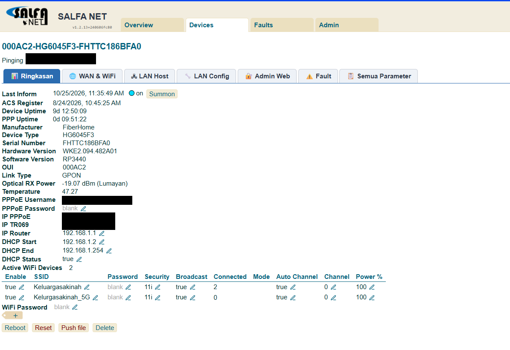
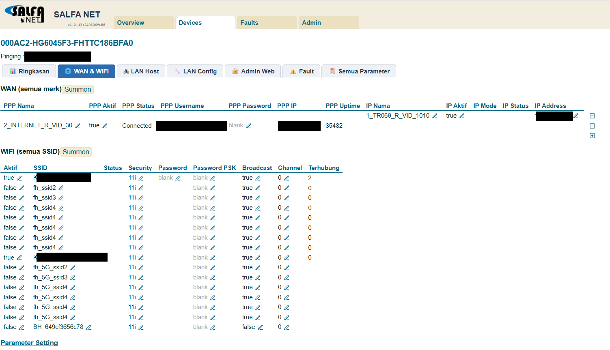
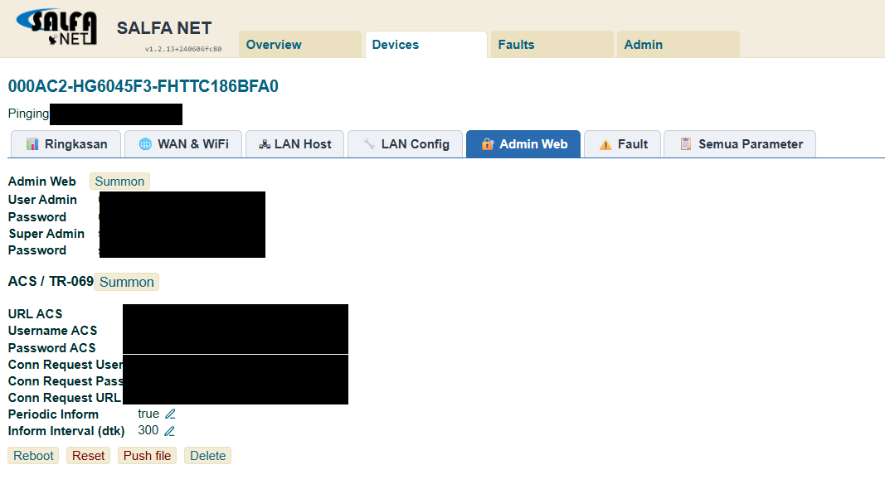

# Genieacs-Multitab

Paket tampilan dan otomasi untuk **GenieACS 1.2.x** (TR-069 ACS). Dipakai untuk mengelola ratusan ONT/modem pelanggan ISP (Huawei, ZTE, FiberHome, Nokia/ALCL, C-Data, CMCC/CT-COM, dll).

Semuanya dipasang lewat **data MongoDB** (Config, Virtual Parameters, Provisions). Kode program GenieACS tidak di-patch. Hanya fitur branding yang menulis 2 file tampilan, dan itu opsional.

## Screenshot

| Ringkasan | WAN & WiFi | Admin Web (incl. ACS) |
|---|---|---|
|  |  |  |

*Diambil dari instalasi produksi (±600 ONT); kredensial dan IP pada gambar sudah ditutup.*

## Fitur

| Fitur | Keterangan |
|---|---|
| **Halaman device multi-tab** | 📊 Ringkasan · 🌐 WAN & WiFi · 🖧 LAN Host · 🔧 LAN Config · 🔐 Admin Web · ⚠️ Fault · 📋 Semua Parameter. Klik tab untuk berpindah isi, tanpa scroll panjang. Berlaku otomatis untuk semua device, termasuk ONT baru. |
| **WAN & WiFi umum + per merk** | Tabel WAN/WiFi standar TR-069 untuk semua merk, ditambah tampilan khusus per merk (VLAN, service list, LAN bind). |
| **LAN Config** | IP LAN, DHCP server (start/end/DNS/gateway/lease), status port LAN. Semua bisa diedit. |
| **Admin Web + ACS** | User/password web ONT (user & superadmin), URL ACS, user/pass ACS, connection request, interval inform, dengan tombol Summon. |
| **29 Virtual Parameter** | RX power/redaman, suhu, mode PON, uptime, PPPoE (user/IP/password), SSID aktif + jumlah client, user/superadmin web ONT lintas merk (termasuk Nokia/ALCL). |
| **Branding** | Ganti logo dari **Admin → Files**, judul/subtitle/warna header dari **Admin → Config** (`branding.*`). |
| **Bot Telegram** (opsional) | Cek ONT, cari pelanggan, ONT offline, redaman buruk, fault, ganti SSID/password WiFi, refresh, reboot (dengan konfirmasi), alert fault, dan asisten AI yang hanya membaca. |
| **Bot WhatsApp** (opsional) | Perintah sama persis dengan bot Telegram (lewat Baileys/scan QR — baca risikonya di [docs/WHATSAPP-BOT.md](docs/WHATSAPP-BOT.md) sebelum pasang). |
| **Asisten AI multi-provider** | `/tanya` bisa pakai Claude langsung, atau [OpenRouter](https://openrouter.ai)/OpenAI/endpoint OpenAI-compatible lain — ganti provider dari Admin → Config, tanpa restart bot. |
| **Provision opsional** | Setel ACS/inform, paksa user/password web ONT, buka web ONT dari WAN, buat WAN PPPoE di Nokia. |

## Instal cepat

> **Belum punya GenieACS sama sekali?** Mulai dari [docs/GENIEACS-FRESH-INSTALL.md](docs/GENIEACS-FRESH-INSTALL.md) (Node, MongoDB, GenieACS, systemd, firewall) sebelum lanjut ke bawah.

Di server GenieACS yang sudah jalan (user yang bisa menjalankan `mongo`/`mongosh`):

```bash
git clone https://github.com/s4lfanet/Genieacs-Multitab.git
cd Genieacs-Multitab
bash scripts/install.sh --dry-run   # lihat rencana, tidak menulis apa pun
bash scripts/install.sh             # pasang UI + VP + provisions (backup & rollback otomatis)
```

Setelah itu buka GenieACS, tekan **Ctrl+F5**, dan buka salah satu device.

Installer otomatis mem-backup config, VP, provisions, dan presets ke `backups/<waktu>/`. Kalau UI tidak sehat setelah instal, installer langsung rollback. Rollback manual: `bash scripts/restore.sh backups/<waktu>`.

Panduan lengkap ada di **[docs/INSTALL.md](docs/INSTALL.md)**.

## Dokumentasi

| Dokumen | Isi |
|---|---|
| [docs/GENIEACS-FRESH-INSTALL.md](docs/GENIEACS-FRESH-INSTALL.md) | Instal GenieACS dari nol (server belum punya GenieACS sama sekali) |
| [docs/INSTALL.md](docs/INSTALL.md) | Prasyarat, langkah instal, opsi installer, verifikasi, uninstall |
| [docs/MULTITAB.md](docs/MULTITAB.md) | Cara kerja tab, daftar isi tiap tab, cara menambah tab/bagian |
| [docs/PROVISIONS-VP.md](docs/PROVISIONS-VP.md) | Daftar Virtual Parameter & provision, preset opsional, catatan per merk |
| [docs/BRANDING.md](docs/BRANDING.md) | Ganti logo, judul, warna header |
| [docs/TELEGRAM-BOT.md](docs/TELEGRAM-BOT.md) | Bot Telegram, perintah, & asisten AI (multi-provider) |
| [docs/WHATSAPP-BOT.md](docs/WHATSAPP-BOT.md) | Bot WhatsApp (opsional) — baca risikonya sebelum pasang |
| [docs/BACKUP-RESTORE.md](docs/BACKUP-RESTORE.md) | Backup/restore config & database |
| [docs/TROUBLESHOOTING.md](docs/TROUBLESHOOTING.md) | Masalah umum dan pelajaran dari produksi |

## Struktur repo

```
config/ui-config.json            semua key Config ui.* + branding.* (tampilan)
config/bot-config.example.json   contoh key Config bot.*
virtual-parameters/*.js          29 Virtual Parameter
provisions/*.js                  provision (default, bootstrap, inform2, useradmin2, remoteweb, nokia_pppoe)
presets/presets.json             preset referensi (preset opsional dipasang lewat flag installer)
scripts/install.sh               installer (backup -> import -> cek UI -> rollback bila gagal)
scripts/create-admin.sh          buat/reset user admin + izin penuh (GenieACS fresh install belum punya user)
scripts/backup.sh, restore.sh    backup/restore koleksi GenieACS
scripts/setup-branding.sh        pasang sinkron logo/judul (sudo sekali + cron)
scripts/setup-bot.sh             pasang bot Telegram sebagai service systemd
scripts/setup-wa-bot.sh          pasang bot WhatsApp opsional (Node 20 terpisah + npm, lihat docs/WHATSAPP-BOT.md)
scripts/wa-ui-link.sh            tombol "📱 Bot WA" di bar tab GenieACS -> halaman scan QR di browser
scripts/ui-admin-menu.sh         menu "🤖 Bot" di sidebar Admin (patch 1 file tampilan GenieACS 1.2.13, ada --remove)
branding/branding.js             script sinkron branding
bot/core.js                      logic inti bot (perintah, AI), dipakai bot.js & wa.js
bot/bot.js                       bot Telegram (Node 12+, tanpa npm)
bot/wa.js                        bot WhatsApp opsional (Baileys, butuh Node 20+ & npm, lihat docs/WHATSAPP-BOT.md)
tools/                           alat bantu Huawei (laporan & perbaikan ACL web WAN)
```

## Kompatibilitas

- GenieACS **1.2.x** (diuji di 1.2.13), MongoDB 4.4 dengan shell `mongo` atau `mongosh`, Node 12+.
- Tab memakai CSS `:has()`, jadi perlu browser yang cukup baru: Chrome/Edge 105+, Firefox 121+, Safari 15.4+. Di browser lama semua isi tetap tampil, hanya tanpa tab.
- Teruji di produksi pada ±600 ONT: Huawei HG8145V5/HG8245H5, ZTE F670L/F663NV3A, FiberHome HG6045F3/HG6145D2, Nokia G-1425G-H, C-Data.

## ⚠️ Keamanan

- Installer **default tidak mengubah setelan ONT**. Provision yang menulis ke ONT (`inform2`, `useradmin2`, `remoteweb`) hanya aktif kalau Anda memasang presetnya dengan flag `--preset-*`. Itu pun ditolak selama nilai `GANTI_...` belum diedit.
- `remoteweb` membuka web/SSH/Telnet ONT dari sisi WAN dan melonggarkan firewall ONT. Pakai hanya kalau WAN ONT berada di jaringan manajemen/privat.
- Jangan commit token bot, API key, atau password. Simpan di Admin → Config server Anda, bukan di repo.

## Kredit

- Ide multi-tab terinspirasi dari [alijayanet/genieacs-multitab-mod](https://github.com/alijayanet/genieacs-multitab-mod). Banyak Virtual Parameter berawal dari skrip komunitas ALIJAYA-NET, lalu diperbaiki untuk Nokia, ZTE, FiberHome, dan C-Data.
- [GenieACS](https://genieacs.com) © GenieACS Inc., berlisensi AGPLv3 (tidak disertakan di repo ini).

## Lisensi

[MIT](LICENSE) © 2026 s4lfanet. Bebas dipakai, diubah, dan dibagikan, dengan tetap mencantumkan lisensi. Tanpa garansi: selalu uji di beberapa ONT dulu sebelum menerapkan ke semua.
